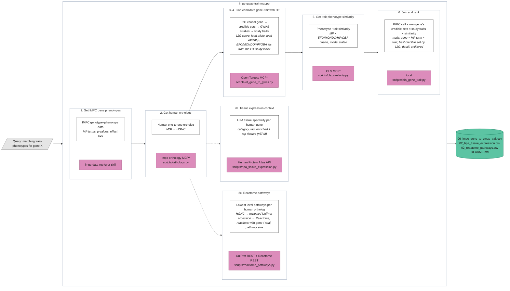
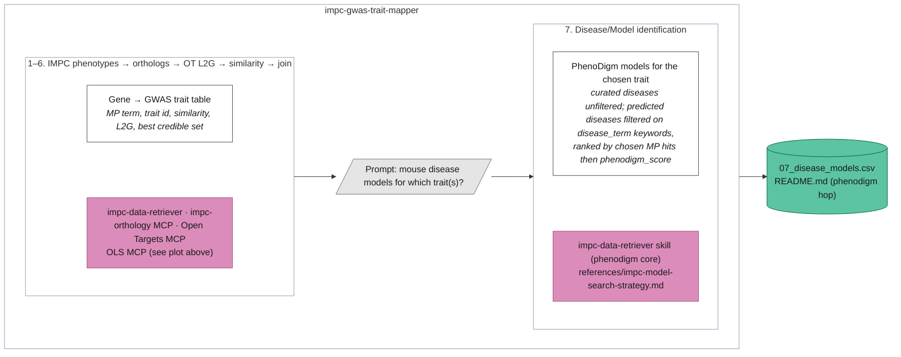

# IMPC-GWAS trait mapper architecture

\* Script listed under the MCP is a fallback; the skill uses whichever is available.

The GWAS Catalog trait cross-check (former step 4) is archived in
`archive/impc-gwas-trait-mapper/gwas-catalog/`; trait ids come from the Open Targets study index only.

## Optional step 7: disease/model identification

Runs only after the table above is shown and the user says yes and names the
trait(s). The search recipe lives in
`references/impc-model-search-strategy.md`.

## Current drawbacks
- GWAS Catalog step archived (MCP unreliable, trait ids redundant with Open Targets); revisit if a reason to prefer the Catalog appears
- OLS MCP fetching terms by top k is not straightforward 
- Reminder: These matches have not undergone statistical testing