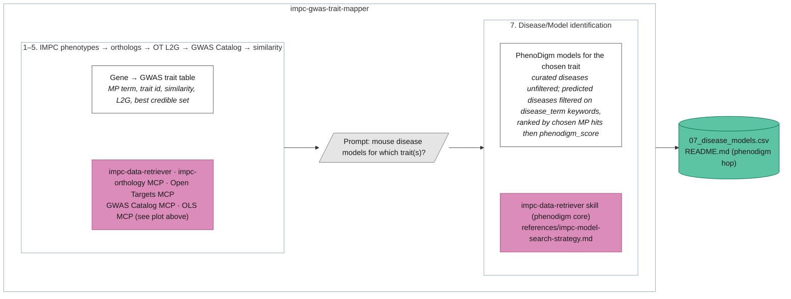

# IMPC-GWAS trait mapper architecture

```mermaid
flowchart LR
    Q[/"Query: matching trait–phenotypes for gene X"/]

    subgraph Skill["impc-gwas-trait-mapper"]
        direction LR
        subgraph P1["1. Get IMPC gene phenotypes"]
            direction TB
            S1["IMPC genotype–phenotype data<br/><i>MP terms, p-values, effect size</i>"]
            R1[impc-data-retriever skill]
            S1 ~~~ R1
        end
        subgraph P2["2. Get human orthologs"]
            direction TB
            S2["Human one-to-one ortholog<br/><i>MGI → HGNC</i>"]
            R2["impc-orthology MCP*<br/>scripts/orthologs.py"]
            S2 ~~~ R2
        end
        subgraph P3["3. Find candidate gene-trait with OT"]
            direction TB
            S3["L2G causal gene → credible sets → GWAS studies<br/><i>L2G score, lead allele, lead-variant β, mapped trait ids</i>"]
            R3["Open Targets MCP*<br/>scripts/ot_gene_to_gwas.py"]
            S3 ~~~ R3
        end
        subgraph P4["4. Cross reference against GWAS catalog"]
            direction TB
            S4["GWAS Catalog cross-check (mandatory)<br/><i>Catalog EFO traits vs step 3 traits: agree / differ</i>"]
            R4["GWAS Catalog MCP / REST v2*<br/>scripts/gwas_catalog_traits.py"]
            S4 ~~~ R4
        end
        subgraph P5["5. Get trait-phenotype similarity"]
            direction TB
            S5["Phenotype–trait similarity<br/><i>MP × EFO/MONDO/HP/OBA cosine, model stated</i>"]
            R5["OLS MCP*<br/>scripts/ols_similarity.py"]
            S5 ~~~ R5
        end
        P1 --> P2 --> P3 --> P4 --> P5
    end

    OUT[("06_impc_gene_to_gwas_trait.csv<br/>README.md")]

    Q --> Skill --> OUT

    classDef source fill:#dc8cbb,stroke:#a0527c,color:#1a1a1a
    classDef skill fill:#8ecdf0,stroke:#0072b2,color:#1a1a1a
    classDef step fill:#ffffff,stroke:#525252,color:#1a1a1a
    classDef output fill:#5cc4a3,stroke:#00664a,color:#1a1a1a
    classDef input fill:#e5e5e5,stroke:#737373,color:#1a1a1a
    classDef group fill:none,stroke:#94a3b8
    class Q input
    class S1,S2,S3,S4,S5 step
    class R1,R2,R3,R4,R5 source
    class OUT output
    class Skill,P1,P2,P3,P4,P5 group
```

\* Script listed under the MCP is a fallback; the skill uses whichever is available.

## Optional step 7: disease/model identification

Runs only after the table above is shown and the user says yes and names the
trait(s). The search recipe lives in
`references/impc-model-search-strategy.md`.

