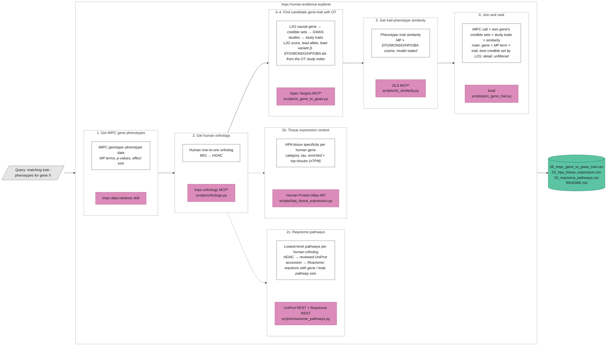

# impc-human-evidence-explorer architecture

\* Script listed under the MCP is a fallback; the skill uses whichever is available.

## Current drawbacks
- Reminder: These matches have not undergone statistical testing